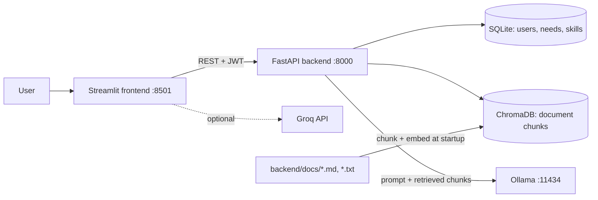
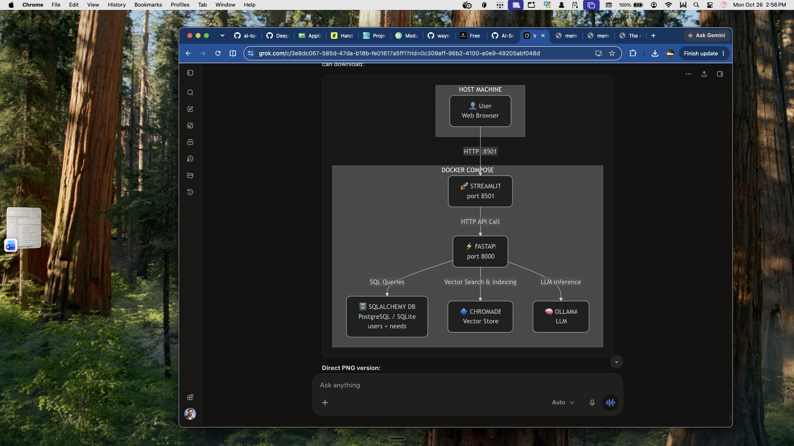

# Needs Manager Dashboard

A full-stack needs/need manager with a built-in community document assistant. The **Needs Manager Dashboard** (FastAPI backend + Streamlit app: JWT login, need management, analytics, Groq AI assistant) is the primary application. The Containerized RAG features (ChromaDB + Ollama question answering over the Blanchester community documents) are integrated into it, so one backend and one frontend serve everything.

## Architecture

| Service   | Image / Build           | Port  | Purpose                                                        |
|-----------|-------------------------|-------|----------------------------------------------------------------|
| `backend` | built from `./backend`  | 8000  | FastAPI: auth, needs (SQLite), document RAG (ChromaDB)         |
| `frontend`| built from `./frontend` | 8501  | Streamlit dashboard (talks to `backend`)                       |
| `ollama`  | `ollama/ollama`         | 11434 | Local LLM server used by the document assistant                |

Volumes: `app_data` (SQLite users/needs), `chroma_data` (vector DB), `ollama_data` (models).

```
 Streamlit dashboard (:8501) --HTTP--> FastAPI backend (:8000) --HTTP--> Ollama (:11434)
                                         |  SQLite (users, needs)
                                         |  ChromaDB <- backend/docs/*.txt|*.md
```

After login a welcome page states the site's purpose, with a **Continue to Dashboard** button.

Matching and the public board: a need can be shared on the board (`is_public`, with optional `contact` text). Matching is keyword-based (`backend/app/matching.py`): need title/description words are compared with skill names (weighted double) and details, ignoring stopwords and simple plurals. Emails are never exposed; only the username and the contact text the poster chose to share.

Dashboard tabs: **Needs Board**, **My Matches**, **Overview** (metrics, table, chart, Groq key link), **Needs** (with a "Need Met" checkbox), **Add New Need**, **Skills I Can Offer**, **AI Assistant** (Groq, optional key in sidebar), **Community Documents** (RAG chat with sources and confidence, re-index button). The sidebar shows API/Ollama status and the number of indexed chunks.

RAG pipeline: `/ingest` chunks each document (`CHUNK_SIZE`, `CHUNK_OVERLAP`) into ChromaDB; `/ask` retrieves the closest chunks, drops those beyond `CONFIDENCE_THRESHOLD`, and asks Ollama. **Guardrail:** with no sufficiently close chunk the LLM is not called and the answer is "I don't know" (`confidence: "none"`).

## Project structure

```
.
├── docker-compose.yml
├── .env.example               # committed template (copy to .env)
├── requirements.txt           # local dev: backend + frontend + test tools
├── ruff.toml                  # lint/format config
├── docs/architecture.png
├── .github/workflows/ci.yml
├── frontend/
│   ├── Dockerfile
│   ├── app.py                 # Streamlit dashboard + AI + document chat
│   ├── BlanchesterOH2.JPG     # faded page background
│   ├── api_client.py          # calls to the backend API
│   └── requirements.txt
└── backend/
    ├── Dockerfile
    ├── requirements.txt
    ├── app/
    │   ├── main.py            # FastAPI app, startup ingestion
    │   ├── config.py          # RAG settings (env vars)
    │   ├── rag.py             # chunking, ingestion, retrieval, generation
    │   ├── auth.py, database.py, exceptions.py
    │   ├── models/, schemas/  # users and needs
    │   └── routers/           # auth.py, needs.py, rag.py
    ├── tests/                 # auth, needs/users, RAG (35 tests)
    └── docs/                  # .txt / .md corpus (see Adding documents)
```





## Tech stack

FastAPI, Pydantic v2, SQLAlchemy 2 (SQLite), JWT (python-jose, passlib/bcrypt), ChromaDB, Ollama (`llama3.2:1b`), Streamlit, pytest + TestClient, ruff, Docker Compose, GitHub Actions CI.

## Usage guide

1. Open http://localhost:8501 and register / sign in.
2. **Add New Need**, then manage it on the **Needs** tab (mark as met, edit, delete). **Overview** shows metrics and charts.
3. **Skills I Can Offer**: add the skills you can contribute.
4. **Community Documents**: ask e.g. "Where can I get food help in Blanchester?". The answer cites its source files and shows a confidence level; off-topic questions return "I don't know based on the provided documents."

## 5-minute demo script

| Time | Show |
|------|------|
| 0:00-2:00 | Log in, ask a question, expand the sources, create/mark/delete a need |
| 2:00-3:00 | Diagram above; `docker-compose up` starts frontend, backend, Ollama; backend talks to SQLite + ChromaDB |
| 3:00-4:00 | Challenge: pinned `chromadb==0.4.22` + `numpy<2` and tuning `CONFIDENCE_THRESHOLD` so irrelevant questions get "I don't know" |
| 4:00-5:00 | Next: document upload endpoint, Alembic migrations, per-user document access, RAG evaluation set |

## Prerequisites

- Docker Desktop (or another Docker engine) **running**
- Docker Compose v2 (`docker-compose` or `docker compose`)

## Quick start

```bash
# 0. Create your local config (first time only) and set SECRET_KEY in .env
cp .env.example .env

# 1. Build and start everything
docker-compose up --build

# 2. The `ollama-pull` service downloads the model automatically on first run
#    (~1.3 GB; the Community Documents tab works once it finishes).
#    To pull manually: docker-compose exec ollama ollama pull llama3.2:1b

# 3. Verify
curl http://localhost:8000/health
```

Expected response:

```json
{"status":"healthy","ollama":"connected","ollama_url":"http://ollama:11434","documents":164}
```

Dashboard: http://localhost:8501 (the model must be pulled first for the Community Documents tab)

Create a user (once) at http://localhost:8000/docs via `POST /auth/register`, e.g. `{"username": "admin", "email": "admin@example.com", "password": "password123"}` (local demo only), then sign in on the dashboard.

Interactive API docs: http://localhost:8000/docs

## Configuration

RAG settings are centralized in `backend/app/config.py` (a `Settings` class) and read from environment variables. Docker Compose loads them into the `backend` container from `.env` via `env_file: .env`.

Setup:

```bash
cp .env.example .env    # then edit .env with your own values
```

- `.env` holds your real local values and is git-ignored and Docker-ignored (never committed or baked into the image).
- `.env.example` is the committed template with safe placeholder values.

| Variable               | Default (in `config.py`) | Description                                   |
|------------------------|--------------------------|-----------------------------------------------|
| `SECRET_KEY`           | *(required)*             | Signs login JWTs; backend refuses to start without it |
| `DATABASE_URL`         | `sqlite:///./needs.db` | Users/needs database (set to a volume path in Compose) |
| `INGEST_ON_STARTUP`    | `true`                   | Index `DOCS_DIRECTORY` when the backend starts |
| `OLLAMA_URL`           | `http://localhost:11434` | Ollama server URL (`http://ollama:11434` in Compose) |
| `MODEL_NAME`           | `llama3.2:1b`            | Ollama model name                             |
| `CHROMA_PATH`          | `./chroma_data`          | ChromaDB persistence directory                |
| `COLLECTION_NAME`      | `documents`              | ChromaDB collection name                      |
| `MAX_RESULTS`          | `3`                      | Number of documents to retrieve               |
| `CONFIDENCE_THRESHOLD` | `1.2`                    | Retrieval distance threshold                  |
| `CHUNK_SIZE`           | `800`                    | Max characters per chunk                      |
| `CHUNK_OVERLAP`        | `100`                    | Overlap when splitting very long paragraphs   |
| `DEBUG`                | `false`                  | Print the loaded config at startup when `true` |
| `DOCS_DIRECTORY`       | `./docs`                 | Directory of `.txt`/`.md` files to ingest           |
| `OPENAI_API_KEY`       | *(empty)*                | Optional cloud fallback key (keep in `.env` only) |

To change a value, edit `.env` and recreate the container (a plain restart does not reload `.env`):

```bash
docker compose up -d backend
curl http://localhost:8000/    # "model" reflects MODEL_NAME
```

If you change `MODEL_NAME`, pull the model too: `docker compose exec ollama ollama pull <model>`.

## API endpoints

Interactive docs: http://localhost:8000/docs. 🔒 = requires `Authorization: Bearer <token>` from `/auth/login`.

| Method | Path                   | Description                                                        |
|--------|------------------------|--------------------------------------------------------------------|
| GET    | `/`                    | Basic status message and configured model                          |
| GET    | `/health`              | Backend status, Ollama connectivity, and chunk count               |
| POST   | `/auth/register`       | Create a user, returns a token                                     |
| POST   | `/auth/login`          | Form login (`username`, `password`), returns a token               |
| GET    | `/users/me` 🔒         | Current user                                                       |
| GET/POST/DELETE | `/skills/` 🔒 | List / add / remove the skills you can offer |
| GET/POST | `/needs/` 🔒         | List (filters: `completed`, `priority`, `skip`, `limit`) / create needs |
| GET/PATCH/DELETE | `/needs/{id}` 🔒 | Read / update / delete your need                              |
| POST   | `/needs/{id}/suggest` 🔒 | Suggested action for a need                                      |
| GET    | `/stats` 🔒            | `{"document_count": N}` (indexed chunks)                           |
| GET    | `/board/` 🔒           | Public needs board: open needs neighbors chose to share (`search`, `skip`, `limit`) |
| GET    | `/board/matches` 🔒    | Public needs from others that fit your skills, best match first    |
| GET    | `/needs/{id}/matches` 🔒 | Neighbors whose skills fit one of your needs                     |
| POST   | `/ask` 🔒              | Body `{"question": "..."}`; returns `answer`, `sources`, `confidence` |
| POST   | `/ask/stream` 🔒       | Same body as `/ask`; streams NDJSON events: `meta` (sources, confidence) then `token`s |
| POST   | `/ingest` 🔒           | Re-chunk and re-load all `backend/docs/*.txt|*.md` files           |

## Adding documents

1. Drop `.txt` or `.md` files into `backend/docs/`.
2. Rebuild so they are copied into the image: `docker-compose up --build -d`.
3. Documents are ingested automatically at startup (or call `POST /ingest`). Chunks are keyed by `filename::chunk_index` and a file's old chunks are replaced, so re-running does not create duplicates. `documents` counts chunks, not files.

Check the count with `curl http://localhost:8000/health`.

## Tests

```bash
# locally (Python 3.11+)
python -m venv .venv && source .venv/bin/activate
pip install -r requirements.txt
cd backend && python -m pytest tests -q

# lint and format (also run in CI)
ruff check backend/app backend/tests frontend && ruff format --check backend/app backend/tests frontend

# or inside the container
docker compose exec backend sh -c "pip install pytest 'httpx<0.28' && python -m pytest tests -q"
```

## Common commands

```bash
docker-compose up -d --build        # start in background
docker-compose logs -f backend      # follow backend logs
docker-compose ps                   # service status
docker-compose down                 # stop containers (keeps volumes)
docker-compose down -v              # stop and delete volumes (wipes DB and models)
docker-compose build --no-cache backend   # force a clean backend rebuild
```

## Troubleshooting

- **`failed to connect to the docker API ... docker.sock`** – Docker isn't running. Start Docker Desktop (`open -a Docker`) and wait until it's ready (`docker info`).
- **`np.float_ was removed in the NumPy 2.0 release`** – `chromadb==0.4.22` needs `numpy<2`. This is pinned in `requirements.txt`; rebuild with `--no-cache` if you see a stale image.
- **`get_or_create_collection() got an unexpected keyword argument 'configuration'`** – that argument exists only in newer ChromaDB. With 0.4.x use `metadata={"hnsw:space": "cosine"}` (as `routers/rag.py` does).
- **`ERR_CONNECTION_REFUSED` on localhost:8000** – the backend crashed or isn't up. Check `docker-compose logs backend`.
- **`documents: 0` in `/health`** – ensure `.txt`/`.md` files exist in `backend/docs/`, rebuild, or call `POST /ingest`.
- **`ollama: unavailable`** – confirm the `ollama` container is running and the model is pulled.
- **Backend exits with `SECRET_KEY is not configured`** – set `SECRET_KEY` in `.env`.
- **`POST /ask` returns 404** – you are running an old backend image; rebuild with `docker-compose up -d --build`.
- **`/ask` returns 502 "Ollama error"** – the model isn't pulled or Ollama is down: `docker-compose exec ollama ollama pull llama3.2:1b`.
- **Answer is "I don't know"** – no document matched closely enough (see `CONFIDENCE_THRESHOLD`); add relevant files to `backend/docs/`.
- **"Failed to send telemetry event"** – harmless log noise from the pinned ChromaDB version.

## Notes

- The first backend start downloads Chroma's default embedding model (~79 MB) into the container; it is re-downloaded if the container is recreated.
- CORS only allows the Streamlit origin (`http://localhost:8501`); adjust in `backend/app/main.py` for other deployments.
- Document endpoints require login; `/health` and `/` stay public.
- The dashboard uses `/ask/stream`, so answers appear token by token; the first answer can still start slowly while Ollama loads the model.
